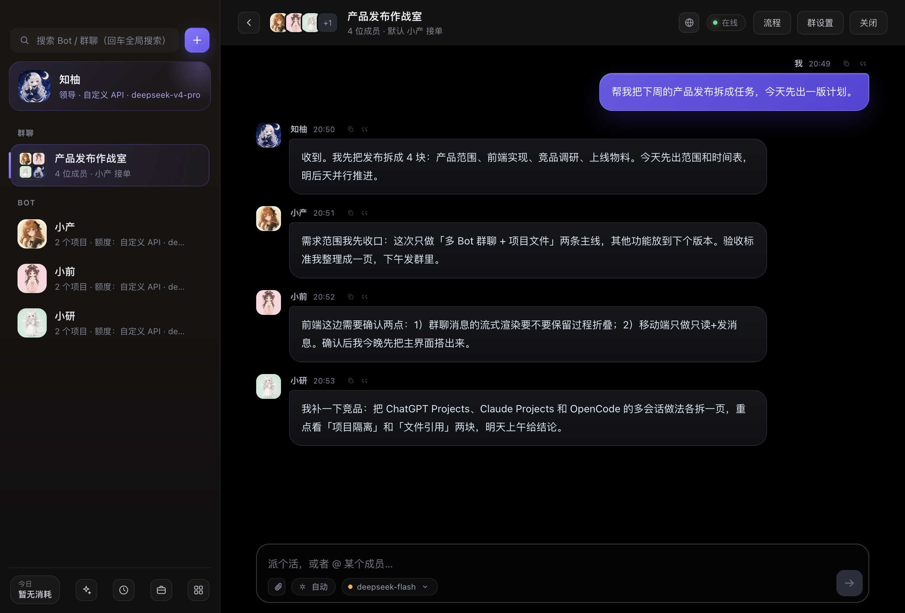
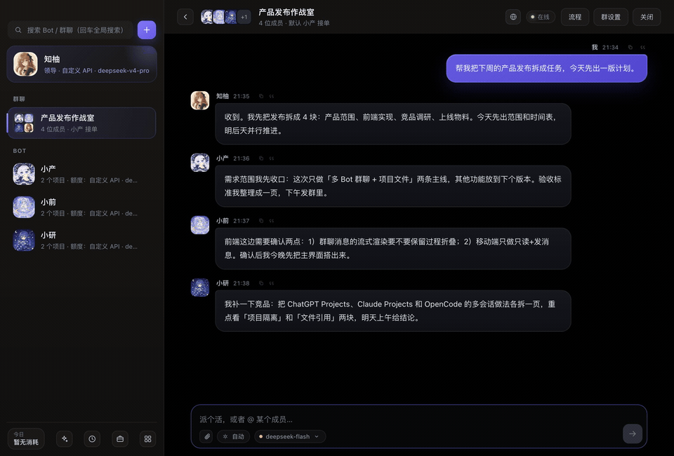
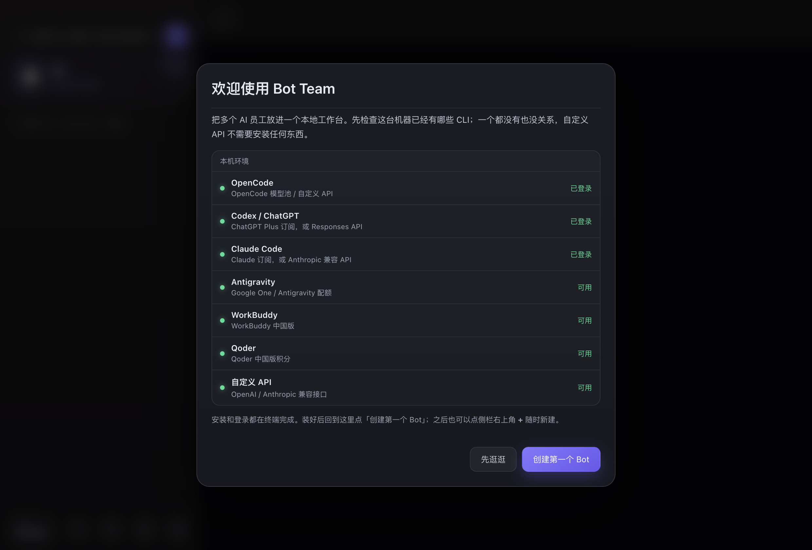

# Bot Team

[简体中文](README.md) | **English**

A local-first multi-agent workspace for macOS. Each bot has its own model backend, memory, workspace, and sessions. Put them in group chats, hand off tasks, run workflows, and keep everything on your machine.





[Watch the 13-second demo (MP4)](docs/screenshots/demo.mp4)

> **Status:** early open source (v0.1.0), macOS only. Windows / Linux are not supported yet.

## Why

Most AI chat apps give you one assistant in one window. Bot Team is built around a small team:

- **Multiple bots, multiple backends** — ChatGPT/Codex, Claude Code, OpenCode, Antigravity, WorkBuddy, Qoder, or any OpenAI/Anthropic-compatible API.
- **Group chats and handoffs** — a lead bot splits work, assigns it, and summarizes the result.
- **Real local work** — read/write files, run commands, browse pages, edit Office/PDF files, transcribe video.
- **Local-first** — state, memory, sessions and API keys stay under `~/Library/Application Support/Bot Team/`.
- **Usage and quotas** — per-day/model/CLI/bot/project token accounting, plus balance/quota cards where the provider exposes them.



## Install (unsigned build)

Download the latest DMG from [Releases](https://github.com/zhuoyulang-123456/bot-team/releases):

- Apple Silicon: `Bot-Team-<version>-arm64.dmg`
- Intel Mac: `Bot-Team-<version>-x64.dmg`

The current build is **not signed or notarized** (an Apple Developer Program membership is required for that). On first launch macOS may block it. Either right-click the app → **Open**, or run:

```bash
xattr -dr com.apple.quarantine "/Applications/Bot Team.app"
```

The app itself is fully functional; the warning is only Gatekeeper.

## Requirements

- macOS 13+
- Optional CLIs, depending on which backend you want:

| Backend | Command | Install | Login |
|---|---|---|---|
| OpenCode | `opencode` | `npm i -g opencode-ai` | `opencode auth login` |
| Codex / ChatGPT | `codex` | `npm i -g @openai/codex` | `codex login` (ChatGPT OAuth) |
| Claude Code | `claude` | `npm i -g @anthropic-ai/claude-code` | `claude`, then `/login` |
| Antigravity | `agy` | Install the Antigravity CLI separately (not on npm) | `agy` Google login |
| WorkBuddy | `codebuddy` | `npm i -g @tencent-ai/codebuddy-code` | `codebuddy` login |
| Qoder | `qoderclicn` | Install the Qoder China CLI | `qoderclicn` login |

No CLI at all? Choose **Custom API** and enter a Base URL + API key. It can chat, but cannot read/write files or run commands.

On first launch Bot Team checks which CLIs are installed and guides you through creating the first bot. The first bot automatically becomes the team lead and gets a default project chat.

## Accounts and balances

Bot Team shows **what the provider actually exposes**. It does not invent numbers.

| Account | What you see | Requirement |
|---|---|---|
| ChatGPT / Codex | plan, subscription end, 5-hour / weekly usage | local `codex login` |
| OpenCode Go | 5-hour / weekly / monthly quota | OpenCode login or API key |
| Antigravity | Gemini / Claude / GPT quota | Antigravity running locally (or a historical snapshot from Antigravity Tools) |
| Qoder | remaining / total credits | Qoder PAT entered in Usage → Connect API accounts |
| Claude | **no official remaining quota**; subscription status + local token/cost estimate | — |
| WorkBuddy | **no official remaining credits**; subscription status + token-based estimate | — |

API balances: DeepSeek, Kimi/Moonshot, Zhipu GLM, MiniMax, MiMo, OpenCode Go. OpenAI API, Anthropic API, OpenRouter, SiliconFlow, Qwen, local Ollama/LM Studio can be used for chat but do **not** show a balance card.

Usage only includes calls made through Bot Team. Historical usage in other tools is not imported.

## Build from source

```bash
npm install
npm run desktop     # Electron window
npm start           # server only, http://127.0.0.1:4820
npm run dist        # current arch DMG
npm run dist:all    # arm64 + x64 DMG/ZIP
npm run check       # syntax check
```

Signing & notarization (optional, requires a paid Apple Developer account):

```bash
npm run sign:check
APPLE_KEYCHAIN_PROFILE=BT_NOTARY npm run dist
```

See the Chinese README for the full certificate, notarytool, and GitHub Actions setup.

## Privacy and security

- Data lives locally: `~/Library/Application Support/Bot Team/` (`data/`, `bots/`, `groups/`).
- API keys are stored in `state.json` with `0600` permissions. They are not uploaded anywhere, but they are not Keychain-encrypted either. Use a dedicated macOS account on shared machines.
- A bot with `full` permission can run shell commands and read/write files. Review permissions before enabling it.
- The local HTTP server is for the app UI. Remote/mobile access requires a token in the URL; do not share a tokenized link.
- Report security issues privately — see [SECURITY.md](SECURITY.md).

## License

MIT. See [LICENSE](LICENSE). Contributions are welcome — read [CONTRIBUTING.md](CONTRIBUTING.md) and [CODE_OF_CONDUCT.md](CODE_OF_CONDUCT.md).
