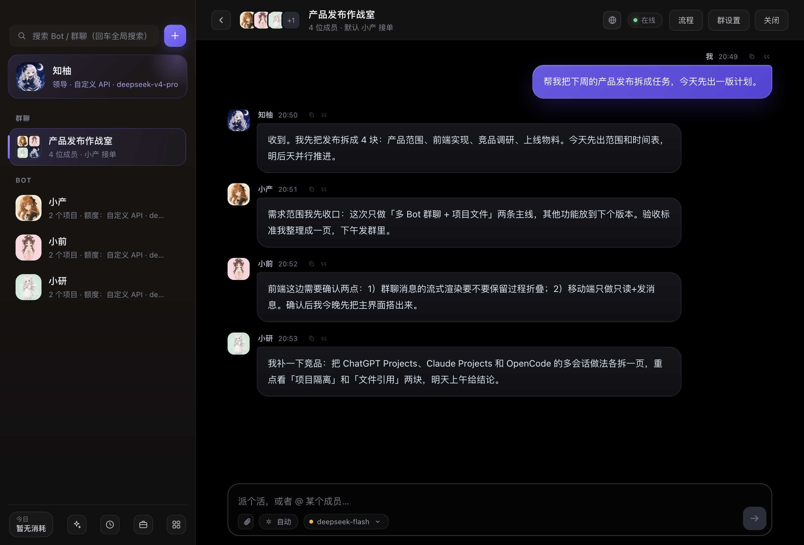
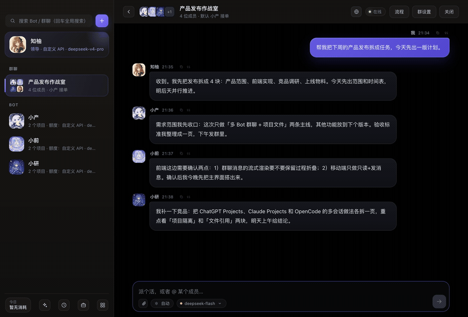
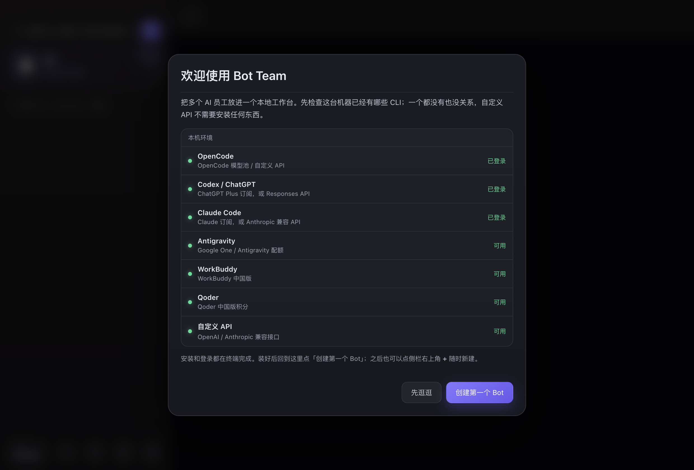

# Bot Team

[**简体中文**](README.md) | [English](README.en.md)

本地多 bot 工作台。每个 bot 有自己的模型后端、独立记忆、独立工作区，可以私聊，也可以拉进群互相转交任务。





[观看 13 秒演示（MP4）](docs/screenshots/demo.mp4)

> 技术架构、数据格式、完整 API、已知限制和优化清单见 **[ARCHITECTURE.md](ARCHITECTURE.md)**（给接手优化的 agent 用）。
>
> **开源版说明**：MIT License，当前主要支持 macOS 13+（Apple Silicon / Intel）。Windows / Linux 还没有完整适配；打包、签名和常见问题见下面的「桌面版」。

## 下载与安装

- Releases：<https://github.com/zhuoyulang-123456/bot-team/releases>
- Apple Silicon 选 `Bot-Team-<version>-arm64.dmg`；Intel Mac 选 `Bot-Team-<version>-x64.dmg`
- 当前包默认未签名/未公证，第一次打开如果提示「无法验证开发者」：右键 App →「打开」，或在终端执行：
  ```bash
  xattr -dr com.apple.quarantine "/Applications/Bot Team.app"
  ```
- 安装后第一次启动会走「本机环境」向导；不装任何 CLI 也能用「自定义 API」开始。

## 跑起来

```bash
cd bot-team
npm start
```

打开 http://127.0.0.1:4820

数据都在本地：`data/state.json`（bot 配置和消息）、`bots/<id>/memory.md`（长期记忆）、`bots/<id>/workspace/`（工作区）。

## 环境要求

- **macOS 13+**；默认打包 arm64，`npm run dist:all` 可同时构建 arm64 + x64
- **Node.js 22+**（只用于开发和构建；安装包自带 Electron 运行时，最终用户不需要装 Node）
- **可选 CLI**（按你要用的后端安装，不需要全装）：

| 后端 | 命令 | 安装 | 登录 |
|---|---|---|---|
| OpenCode | `opencode` | `npm i -g opencode-ai` | `opencode auth login` |
| Codex / ChatGPT | `codex` | `npm i -g @openai/codex` | `codex login`（必须用 ChatGPT 账号 OAuth） |
| Claude Code | `claude` | `npm i -g @anthropic-ai/claude-code` | `claude` 然后输入 `/login` |
| Antigravity | `agy` | 单独安装 Antigravity CLI（不在 npm 上，需从 Antigravity 生态获取） | `agy` 登录 Google 账号 |
| WorkBuddy | `codebuddy` | `npm i -g @tencent-ai/codebuddy-code` | `codebuddy` 登录 WorkBuddy 账号 |
| Qoder | `qoderclicn` | 安装 Qoder 中国版 CLI | `qoderclicn` 登录 |

- **不想装任何 CLI**：直接用「自定义 API」后端，填 Base URL + API Key 就能聊天（只能对话，不能读写文件或执行命令）。
- 如果 CLI 已经装好但应用找不到，先确认它在 `~/.local/bin`、`/opt/homebrew/bin` 或 `npm -g` 的 bin 目录里；Bot Team 会按这些目录找绝对路径。

## 首次启动



第一次打开会弹「欢迎 / 本机环境」：

1. 自动检查 `opencode` / `codex` / `claude` / `agy` / `codebuddy` / `qoderclicn` 是否安装、是否登录；
2. 选一个后端创建第一个 Bot（第一个 Bot 自动成为「领导」）；
3. 没有 CLI 就选「自定义 API」，填 DeepSeek / OpenAI / Anthropic 等 Key；
4. 点「先逛逛」也可以，之后点侧栏右上角的 **+** 新建。

已有 `data/state.json` 的老用户不会看到这个向导。

## 桌面版

```bash
npm install          # 第一次需要，会装 electron
npm run desktop      # 直接开窗口，开发时用
npm run dist         # 打包成 dmg，产物在 release/
```

- 桌面版数据在 `~/Library/Application Support/Bot Team/`（`data/`、`bots/`），和命令行版互不干扰
- 从 Finder 启动时，应用会自动把登录 shell 的 `PATH` 补进来，所以 `opencode` / `codex` / `agy` 照样能找到
- 菜单里可以「打开数据文件夹」；`⌘K` 聚焦搜索，`⌘R` 重新载入
- 窗口是原生 hiddenInset 标题栏，左上角红绿灯直接可用
- 国内网络打包时如果卡在下载 Electron，可以加镜像：`ELECTRON_MIRROR=https://npmmirror.com/mirrors/electron/ npm run dist`

### 构建、签名与代理

```bash
npm run dist        # 当前机器架构，dmg
npm run dist:all    # arm64 + x64，dmg + zip
npm run check       # 全仓库 JS 语法检查
```

- 未签名的包在别人 Mac 上会被 Gatekeeper 拦。可以右键 →「打开」，或：
  ```bash
  xattr -dr com.apple.quarantine "/Applications/Bot Team.app"
  ```
### 签名与公证（正式发布建议）

先检查本机条件：

```bash
npm run sign:check
```

**1. 需要 Apple Developer Program（付费）和一张 `Developer ID Application` 证书。**

- 有 Xcode：Xcode → Settings → Accounts → 添加 Apple ID → Manage Certificates → `+` → `Developer ID Application`
- 没有 Xcode：钥匙串访问 → 证书助理 →「从证书颁发机构请求证书」→ 保存 CSR → 到 [developer.apple.com](https://developer.apple.com/account/resources/certificates) → Certificates → `+` → Developer ID Application → 上传 CSR → 下载 `.cer` 双击安装
- 验证：
  ```bash
  security find-identity -v -p codesigning
  ```
  应该看到 `Developer ID Application: ... (TEAMID)`

**2. 准备公证凭据。**

- Team ID：developer.apple.com → Membership
- App 专用密码：appleid.apple.com → Sign-In and Security → App-Specific Passwords

推荐存进 Keychain（密码不会进 shell 历史）：

```bash
xcrun notarytool store-credentials "BT_NOTARY" \
  --apple-id "you@example.com" \
  --team-id "TEAMID"
```

然后构建：

```bash
APPLE_KEYCHAIN_PROFILE=BT_NOTARY npm run dist
```

也支持 App Store Connect API Key：

```bash
APPLE_API_KEY=/path/AuthKey_XXXX.p8 APPLE_API_KEY_ID=XXXX APPLE_API_ISSUER=xxxx npm run dist
```

或 Apple ID 环境变量：`APPLE_ID`、`APPLE_APP_SPECIFIC_PASSWORD`、`APPLE_TEAM_ID`。

`electron-builder` 会用 Developer ID 证书 + hardened runtime 签名，`build/notarize.cjs` 调 `notarytool` 公证，完成后 DMG 里的 App 可以直接分发。

**3. 验证：**

```bash
spctl -a -vvv -t install "/Applications/Bot Team.app"
codesign --verify --deep --strict --verbose=2 "/Applications/Bot Team.app"
xcrun stapler validate "/Applications/Bot Team.app"
```

**4. CI 签名（可选）：**

在 GitHub Secrets 里配置：

- `CSC_LINK`：导出的 `.p12` 证书的 base64
- `CSC_KEY_PASSWORD`：`.p12` 密码
- `APPLE_ID`、`APPLE_APP_SPECIFIC_PASSWORD`、`APPLE_TEAM_ID`

workflow 会自动传给 electron-builder；没配就产出未签名包。不要把证书、密码、`.p8` 提交到仓库。

GitHub Actions 已配置：打 `v*` tag 会自动构建 arm64 + x64 并上传到 Release。
- **代理**：设置 →「网络代理」留空会自动检测 macOS 系统代理（Clash / Surge 等），也可以手填 `http://127.0.0.1:7897`；填 `direct` 强制直连。只支持 HTTP(S) 代理；SOCKS-only 请用 TUN 模式。CLI 会继承同一个 `HTTPS_PROXY`。

## 七种模型后端

| 后端 | 走什么额度 | 配置 |
|---|---|---|
| `opencode` | OpenCode 的模型池 / 你配的 API | `opencode/gpt-5.5`、`opencode/deepseek-v4-pro`… |
| `codex` | ChatGPT Plus 订阅，或自定义 API | 模型可留空；自定义时填 Responses API 兼容地址 |
| `claude` | Claude Code 本机登录，或自定义 API | 模型可留空；自定义时填 Anthropic 兼容地址 |
| `agy` | Google One / Antigravity | `gemini-3.8-flash-high`… |
| `codebuddy` | WorkBuddy 中国版 / CodeBuddy CLI | 模型可留空，或 `deepseek-v4.1-flash`、`hy3`… |
| `qoder` | Qoder 中国版（`qoderclicn`） | 模型可留空，或 `Qwen3.8-Flash`、`DeepSeek-V4-Pro`… |
| `custom` | 你填的 URL + API Key | OpenAI 兼容或 Anthropic 兼容；无需安装任何 CLI |

### Claude Code / Codex 的接入方式（类似 cc-switch）

每个 Bot 可以单独选：

- **本机登录 / 官方订阅**：沿用本机 Claude Code / Codex 当前登录或全局配置（如果你用 cc-switch 把 Claude Code 接到了第三方，这里也会沿用）
- **自定义 API（仅这个 Bot）**：填 Base URL、API Key、模型名，只对当前 Bot 生效，不影响全局配置

注意：

- Claude Code 自定义需要 **Anthropic 兼容**接口，例如 `https://api.deepseek.com/anthropic`
- Codex 自定义需要 **Responses API 兼容**接口（新版 Codex 已不支持 `wire_api=chat`）
- `custom` 后端不需要任何 CLI，直接走 HTTP；这种模式只能对话，不能读写文件或执行命令

### 常用服务商预设

自定义 URL 里可以直接选：

DeepSeek / OpenAI / Anthropic / Kimi / 智谱 GLM / MiniMax / 通义千问 / 小米 MiMo / OpenRouter / SiliconFlow / 本地 Ollama / 本地 LM Studio

选中后会自动填好对应的 Base URL 和推荐模型，也可以手动改。Claude Code 只会列出支持 Anthropic 兼容接口的服务商，Codex 只列出支持 Responses API 的服务商。

填好 URL 和 Key 后，模型一栏可以点 **「拉取模型」**：会用当前 Base URL + API Key 调 `/v1/models`，把该账号可用的模型全部拉下来，直接在下拉和「浏览」里挑选，不需要手敲模型名。

拉取到的模型会**全部保存**在这个 Bot 上：

- 设置里选的只是「默认模型」
- 聊天输入框底部的模型切换器会列出全部已拉取模型，可以随时切换（例如 DeepSeek Flash ↔ Pro）
- 第一次打开模型切换器时，如果还没拉取过，会自动用已保存的 URL + Key 拉一次

### 计费方式不再手动选

「订阅 / 按量 / 免费」现在由后端和来源自动决定：

- 本机订阅（ChatGPT Plus、Claude 订阅、Google One、WorkBuddy、Qoder、OpenCode Go）→ 订阅
- 自定义 URL / API Key、DeepSeek/Kimi/GLM 等按量来源 → 按量
- 免费模型 → 免费

界面上只读显示计费方式，避免出现「自定义 API 却选订阅」这种矛盾配置。

新建或编辑 bot 时选后端、填模型即可。模型下拉框会自动从各 CLI 拉取：`opencode models`、`agy models`、`codex debug models`、`codebuddy --help`、`qoderclicn --list-models`。

## 额度来源与模型

**来源决定能选哪些模型**（按 `opencode models` 的 provider 前缀），不再是随便贴个标签：

| 来源 | 模型前缀 | 计费 |
|---|---|---|
| OpenCode Go | `opencode-go/*` | 订阅 |
| OpenCode API | `opencode/*` | 按量 |
| ChatGPT Plus | `codex debug models` 里的模型（Gpt-6.1-Sol 等） | 订阅 |
| WorkBuddy 中国版 | `codebuddy` 支持的模型（hy3、deepseek-v4.1-flash 等） | 订阅 |
| Qoder 中国版 | `qoderclicn --list-models`（Qwen3.8、DeepSeek-V4 等） | 订阅 |
| Google One | `agy` 自有模型 | 订阅 |
| DeepSeek 按量 | `deepseek/*` | 按量 |
| 智谱 GLM 按量 | `glm/*` | 按量 |
| Kimi 按量 | `kimi/*`、`moonshotai-cn/*` | 按量 |
| MiniMax 按量 | `minimax/*` | 按量 |
| Claude API 按量 | `anthropic/*` | 按量 |
| Claude 订阅 | Claude Code 本机登录 | 订阅 |
| 自定义 API | 自定义 URL + API Key | 按量 |
| Google API 按量 | `google/*` | 按量 |
| 本地代理 | `antigravity-manager/*`、`gemini-web-18m/*` | 按量 |

- 选来源后，模型下拉只列这个来源的模型，并显示可用数量
- 反过来也行：填的模型属于别的 provider 时，来源会自动跟着模型切换
- 换来源会把不匹配的旧模型清掉，避免「DeepSeek 按量 + opencode/claude」这种错配
- 旧数据启动时会自动修：优先在所选来源下找同名模型（如 `opencode/grok-4.7` → `opencode-go/grok-4.7`），找不到才按模型改来源标签

计费方式会跟着来源自动带出（订阅 / 按量 / 免费），也能手动改；标成「按量」时，提示词里会让它省 token。

左侧列表显示的是 `来源 · 模型`，例如 `OpenCode Go · grok-4.7`、`DeepSeek 按量 · deepseek-v4-pro`。想自定义就填「额度标签」，留空自动拼。

**额度消耗**在 bot 设置页里看：今日 / 最近 7 天 / 累计、输入输出、最近 7 天柱状图、最近使用时间，可以一键重置。左下角 ▦ 里还有一个「今日全部 bot 合计」，按来源拆分。

用量按天记账（保留 60 天），`/clear` 不会清它。

注意：这里统计的是「消耗了多少」，拿不到「还剩多少」——订阅额度没有公开接口。

## 账号与余额：哪些能看，哪些看不了

余额分两类，不要混在一起：

**订阅额度 / 配额**

| 账号 | 能显示什么 | 前提 |
|---|---|---|
| ChatGPT Plus / Codex | Plan、订阅到期、5 小时 / 本周用量 | 本机 `codex login`（`~/.codex/auth.json`） |
| OpenCode Go | 5 小时 / 本周 / 本月额度 | 本机 OpenCode 登录或填 Key |
| Antigravity | Gemini / Claude / GPT 的 5 小时 / 本周配额 | Antigravity 正在运行（读本地 language server）；否则读 Antigravity Tools 历史快照 |
| Qoder | 剩余 / 总额 Credits、团队包 | 在「用量中心 → 连接 API 账号」填 Qoder PAT |
| Claude | **看不到官方剩余额度**，只显示「订阅 / 按量使用中」+ 本软件调用估算 | — |
| WorkBuddy | **看不到官方剩余积分**，只显示「订阅制 · N 个 Bot 在用」+ 按 token 估算的消耗 | — |

**API 账户余额**

- 支持真实余额：DeepSeek、Kimi / Moonshot、智谱 GLM、MiniMax、MiMo、OpenCode Go（额度窗口）
- MiMo 需要 App 内登录或浏览器 Cookie（读浏览器登录态可能要「完全磁盘访问权限」）
- **不显示余额**：OpenAI API、Anthropic API、OpenRouter、SiliconFlow、通义、本地 Ollama / LM Studio。它们可以作为自定义 API 聊天，但只统计本软件调用产生的 token / 估算费用
- 订阅额度默认不计入成本；可以在用量中心打开「订阅按 API 价折算」
- 所有统计只包含 Bot Team 记录到的调用，不包含你在其他工具/网页里的历史消费

## 隐私与安全

- 数据都在本机：`data/state.json`、`bots/`、`groups/`；桌面版在 `~/Library/Application Support/Bot Team/`
- API Key 明文保存在 `state.json`（文件权限会收紧到 `0600`），没有上传到任何服务器；多人共用电脑请用独立 macOS 账号
- 桌面版 HTTP 服务只给本机界面用；手机端/远程访问需要链接里的 `bt_token`，不要把带 token 的链接转发给别人
- Bot 的 `full` 权限可以执行 shell 命令、读写文件；给之前先确认工作目录和任务范围
- 发现安全问题请按 [SECURITY.md](SECURITY.md) 私下报告，不要贴 API Key 或聊天记录

## 推理强度（聊天栏滑杆）

输入框左下角有个 `自动` 药丸，点开是 ChatGPT 风格的滑杆：

```
自动 —— 轻度 —— 中度 —— 高度 —— 极高
```

- 每个聊天单独保存，对本聊天里所有 Bot 生效
- `自动` = 不传参数，用模型默认强度
- 后端映射：
  - OpenCode：`--variant low/medium/high/max`（极高对应 max）
  - Codex：`-c model_reasoning_effort=low/medium/high/xhigh`
  - Antigravity：`--effort low/medium/high/xhigh`

## 聊天栏换模型

输入框下方的模型药丸显示当前接单 Bot 的模型，点开就能换：

- 私聊改的就是对方；群聊改的是「默认接单成员」
- 列表只显示这个 Bot 所属来源下的模型：`OpenCode Go` 只列 `opencode-go/*`，`Google One` 只列 agy 的模型，不会串到别的供应商
- 选完直接写回 Bot 设置，左侧额度标签同步更新
- 换模型会清掉这个 Bot 的原生会话（不同模型不能共用同一个 session）
- Codex 多一个「默认模型（留空）」选项
- 列表支持搜索

## 领导 Bot（顶部「我」）

顶部那个「我」就是领导 Bot，默认是 **ChatGPT（Codex 工人）**，可以理解成你的身份/知柚：

- 你在群里、以及和别的 Bot 私聊时，消息都以领导的身份发出（右侧气泡显示领导的名字和头像）
- 领导默认出现在所有群里，但不参与默认接单；`@` 领导时由领导本人处理
- 群里 `@` 某个成员，只让那个成员回；不 `@` 时，群里所有 AI 依次回复，默认接单成员先回
- 点顶部卡片可以单独和领导对话；鼠标移上去点 `⋯` 可以改它的名字、头像、模型
- 只有「和领导的私聊」里，你的消息才显示为「我」，由领导本人回复
- 和领导私聊时点顶栏「定位」，可以指定一个群聊、一个 Bot，或点开某个 Bot 选它的一个 / 几个 / 全部项目；之后发的任务会自动带上 `【定位】群聊「产品发布作战室」 · chat_xxx` 或 `【定位】项目 · Codex bot：「默认项目」(chat_xxx)…` 这样的抬头，领导不用再猜你说的是哪里，可以直接用 ID 去操作
- 「定位」面板里每个群后面直接带「启动流程 / 收尾 / 停止」，不用让领导 Bot 代劳，也不用手动跑命令
- 让领导 Bot「把某群的流程开起来 / 继续跑」时，它会执行 `bt workflow-run <chatId>`，而不是只给成员发消息
- 领导会自己选后端和模型：先 `bt models` 看可用清单，再按任务分配——要读文件/跑命令/抓网页的用有工具的后端（codex / opencode / agy），看截图和长文档用 agy，批量文本判断用 custom 省钱，工程改造用 codex；新成员用 `--backend` / `--model` 指定，并在回复里说明分工理由
- 一句命令就能建团队并跑起来：「新建三个 Bot 组个群，做开源资源收集入库流程，跑起来，把流程图给我」——领导会依次执行 `bt new-bot` → `bt new-group` → `bt workflow` → `bt workflow-run` → `bt workflow-export`，最后把导出的 HTML 路径发给你
- 想换一个 Bot 当这个身份：`▦` → 设置 → 领导 Bot；原来的领导会自动回到 Bot 列表
- 领导会自动带一份岗位说明（拆目标、分派、验收、汇总），可以在 Bot 设置里改
- 群里的接单成员额度不足时，会自动换一位订阅制成员接单，并留一条系统提示

## 群协作


- 群里不 `@` 任何人时，只有群设置里的「默认接单成员」回复，其他成员不吭声
- `@某个成员` 只让那个成员回
- `@所有人` / `@全体成员` / `@all` 才会让群里所有成员都回
- 默认接单成员可以在群设置里换

- **多个 @**：一条消息里 @ 几个成员，几个都会收到；开头、中间、结尾都算
- **@ 所有人**：输入 `@` 选最上面的「所有人」，或者直接打 `@所有人`，群里除知柚外的所有 AI 都会并行回复
- **直连提供商**：可以把常用的 API（比如 DeepSeek）连 URL、Key 和模型一起存成「提供商」，之后 `bt new-bot ... --backend custom --provider deepseek` 直接建 Bot，不用再填 Key
- **全局搜索**：左侧搜索框输入后按回车（或 ⌘K）打开全局搜索，可以搜所有对话里的文字、群文件、附件和消息里的本地文件路径；支持按「消息 / 文件」筛选，也可以点「范围」只搜某几个群聊、某个 Bot 的某几个项目；点结果直接跳到那条消息并高亮
- **模型库**：自定义 API 拉取模型后会列出全部模型，勾选要保留的，点「保存所选」；聊天底部的模型切换只显示保留的这几个，还能在模型库里点「设为默认」
- **极速模式**：`▦` → 设置 → 勾选「极速模式」，所有 Bot 默认用最低推理强度，并压缩最近对话、群日志、团队状态和长期记忆；需要深推理时临时关掉
- **打断 / 插话**：Bot 思考时发送键会变成方块，点一下打断当前思考；输入框旁的「插话」会结束当前这一轮，立刻带着你补充的话继续（原文和上下文都保留）
- **链接与本地文件**：回复里的网页链接会显示成可点链接（带 ↗）；写到回复里的本地文件绝对路径会变成内联文件标签，并在消息底部生成文件卡片，可以「打开 / 在访达中显示 / 复制路径」
- **附件**：输入框左边的回形针可以加图片或文件；也可以直接把图片/文件拖进窗口任意位置，或在聊天页按 ⌘/Ctrl+V 粘贴截图和文件（一次最多 10 个）；图片会作为视觉附件，文件会复制到每个 Bot 的 `attachments/` 并在提示词里给出路径
- **输入框自动长高**：文字换行越多，输入框越高，最多到窗口约 40%，超过后再内部滚动
- **@ 指定回复**：输入 `@` 会自动弹出群成员头像列表（不含领导「我」），可以搜索、↑↓ 选择、Enter 插入；也可以双击消息里某个成员的头像直接 @
- **@ 指定回复（手动）**：`@Antigravity 工人 看一下这个报错`，只有它回
- **不 @ 全员回复**：所有群成员并行处理，各回一条，不用等前一个说完；界面会显示「N 位成员正在处理」
- **群公告**：群设置里填写，所有成员每次回复都会看到
- **群文件**：群设置里上传，运行前会复制到每个成员工作区的 `group-files/`，prompt 里会列出文件名
- **群日志**：自动记录每个 Bot 的接单、回复、转交、浏览器操作、创建和报错，最近 12 条会注入给所有成员
- **拖动排序**：左侧的群聊和 Bot 都可以直接拖动调整上下位置，顺序会保存
- **领导创建**：私聊领导或 `@` 领导说「新建一个 bot 叫 XX，负责 XX」「新建一个群叫 XX，成员是 A、B」，领导会输出 `@@CREATE` 指令，系统执行并回执

### 让领导给别的群 / Bot 发消息

单独私聊领导，直接说人话就行，例如：

> 去作战室说一声今天休息
> 问一下 Antigravity 工人长文档那边的进度

领导会在回复里输出：

```
@@SEND 作战室、Antigravity 工人@@ 今天休息
```

系统会：

1. 以领导的身份把消息发到目标群 / 目标 Bot 的私聊（在群里显示为右侧的领导消息）
2. 发到群里时，如果消息里 `@` 了某个成员，它会接着处理；没有 @ 就只发公告
3. 发到 Bot 时会自动建/复用私聊，并让那个 Bot 直接回复
4. 一次最多 5 个目标，只有领导能用 `@@SEND`，收到消息的 Bot 不能继续往外发，避免套娃
5. 发完会在领导的私聊里留一条「已发送到：…」

## 多个 Google / Antigravity 账号

- Antigravity Bot 设置里选「Antigravity Google 账号」
- 点「添加账号」：会给这个账号创建独立的 HOME，并打开终端让你登录新的 Google 账号
- 每个账号有独立的登录态、会话和缓存，可以同时跑，不会互相覆盖
- **模型列表按账号独立**：`agy models` 会带该账号的 HOME 运行；切换账号会自动拉取新列表，旧账号的模型不会串到新账号
- 如果当前 Bot 的模型不在新账号可用列表里，会自动切到一个该账号可用的模型并提示
- 完成 Google 登录后会自动轮询并刷新账号和模型，不需要手动重开设置
- 「登录」可以重新打开某个账号的终端登录
- 默认账号就是你当前机器上已经在用的 Google 账号
- 如果账号显示「待登录」，先在终端完成登录再用
- 多个 Antigravity Bot 可以分别绑定不同账号并行工作

## 用量中心


左下角「今日 N tokens」现在可以点开：

- 每日 Token 趋势（7 / 30 / 90 天），鼠标悬停柱子会悬浮显示当天 tokens、消耗金额和调用次数
- OpenCode Bot 的用量按每轮对话汇总所有 step（旧版本只记录了最后一个 step，会明显少算）；历史数据会从本机 OpenCode 会话记录自动重建
- 成本计算包含缓存命中的输入（按缓存单价）和推理 tokens（按输出单价）；DeepSeek 使用官方人民币价并区分高峰/空闲时段，其他模型价格来自 models.dev（按 1 USD ≈ ¥7.2 折算，缓存 24 小时）
- **积分（Qoder / WorkBuddy）**：
  - Qoder 每次运行由 CLI 直接返回本轮消耗的 Credits，消息下方和用量中心显示的是精确值
  - WorkBuddy 的 CLI 不返回积分，按 token 估算（默认 31,874 tokens = 1 积分，可在设置里改）
  - 两者的积分按设置里的「每积分单价」折算成人民币（默认 ¥0.072/积分，即 $10/1000 Credits 按 ¥7.2 折算），计入「订阅折算」
  - 消息额度行会显示「X 积分 ≈ ¥Y」；WorkBuddy 会标注「估算」
  - Qoder 在本次更新之前的旧记录没有积分字段，无法补算；新调用开始精确记录
- 成本只统计 Bot Team 记录到的调用，不包含其他工具或本机之外的历史消费；DeepSeek 卡片上的余额是官方剩余充值余额
- 顶部标签切换：按模型 / 按 CLI / 按渠道 / 按 Bot / 按项目·群聊，一次只显示一个维度，避免页面冗长
- 每个条目都可以点击，查看该 Bot / CLI / 渠道 / 项目或群聊下的**具体模型消耗**：各模型 tokens、调用次数、成本占比、每日趋势
- 历史用量的项目/群聊归属会从本机 Bot Team 消息记录恢复；关联到群的私聊也会归入对应群聊
- 删除 Bot / 群聊 / 项目后，历史用量不会消失：会收在对应列表底部的「已删除」折叠区，展开后仍显示原来的 tokens、成本，并标记「已删除」；Bot 还会显示最后使用的模型和额度标签
- 「按项目 / 群聊」里群聊用紫色标识并置顶，项目用绿色标识；点开后可以用「按 Bot / 按模型」标签切换查看具体消耗
- Token 与调用次数
- 成本估算：
  - API 按量渠道按模型单价估算
  - 订阅额度默认不计入，可在面板里打开「订阅按 API 价折算」
- 余额与订阅（只显示已连接/已配置的账号，可按「全部 / API 余额 / 额度 / 订阅」标签切换）：
  - DeepSeek、Kimi、GLM、MiniMax、MiMo 的 API 余额
  - OpenCode Go 的 5 小时 / 本周 / 本月额度
  - ChatGPT Plus / Codex 的 5 小时 / 本周额度
  - Qoder 积分
  - Google One / Antigravity 的 Gemini / Claude / GPT 配额：优先读取本机正在运行的 Antigravity 当前账号实时额度；未运行时回退到历史快照
  - WorkBuddy、Claude 等订阅在 Bot 使用时显示订阅状态
- 面板底部「连接 API 账号」可以填写 DeepSeek / Kimi / GLM / MiniMax / MiMo / OpenCode Go / Qoder 的 Key；只保存在本机 `data/state.json`，不会提交到仓库
- 没有连接/没有 Key 的供应商不会显示占位卡片
- 查询失败的卡片会给出解决入口：更新 Key/Cookie（自动跳到输入框）、打开对应控制台、重试；Antigravity 过期/禁用可直接打开 Antigravity Tools
- MiMo 登录态有三种获取方式：
  - **在 App 内登录**（推荐，任何系统都能用）：弹出 MiMo 登录窗口，登录成功后自动保存，不需要系统权限
  - **自动读取浏览器**：从本机 Chrome / Edge / Brave 的所有 profile 读取已登录会话；macOS 需要给 Bot Team「完全磁盘访问权限」
  - **手动粘贴 Cookie**：兜底方式
- Cookie 过期时先尝试自动恢复；Cookie 只保存在本机 `data/state.json`
- 历史数据：旧数据按 Bot 的日汇总补入，群/项目细分从本次更新后开始完整记录

成本是估算值，以实际账单为准；每次调用的用量会记录到 `data/usage-events.jsonl`。

## 群流程图

每个群可以有一条可发布的流程图，用来自动按顺序跑不同 Bot：

- 「导出」可以把当前流程导成三种文件（默认写到桌面）：HTML 网页、PNG 图片、PDF 文档；都带标题、环节、并行/汇合连线、循环回到起点和图例，HTML 可直接打开或分享，PNG/PDF 适合发给别人或贴进文档；
- 写环节任务时，点任务框右上角「＋ Bot 名」可以一键插入群里任意 Bot 的名字，也可以直接在任务里输入 @ 筛选；
- 群里点「流程」打开设计器；左侧流程图按上下顺序排列环节，并行分支并排显示，循环回到起点时末尾会多一张虚线「下一轮」卡片
- 每个环节可以设置：
  - 执行 Bot
  - 模型（留空跟随 Bot 默认）
  - 任务
  - 下一步：总是 / 成功后 / 失败后 / 输出包含关键词
  - 停止条件：输出包含某段文字就结束整个流程
  - 多个分支、循环、最多步数
- 「保存并发布」后点「运行流程」，Bot 会按流程一步步执行；运行时会自动停掉该群的持续运行
- **完成判定**：
  - 环节正常返回内容即视为完成
  - 然后按「下一步」的条件决定去哪个环节
  - 命中「停止条件」、下一步为「结束流程」，或 Bot 输出 `@@FLOW_END` 时，整个流程结束
- **自动交接**：上一环节完成后，执行 Bot 会在群里自动 `@下一个环节的 Bot`，并把上一环节结果作为输入交给它，下一个 Bot 随即开始执行；群里同时显示「X 完成 · 交接给 Y → 环节」的系统提示
- **流程环节轻量上下文**：每个环节都使用独立会话，只带岗位说明、群公告/群文件、本环节任务和上一环节交接；不重复加载最近聊天、群日志、团队状态和长对话历史，避免流程越跑越慢
  - 每个环节开始前会把群文件（含工作日志）同步到该 Bot 的 `group-files/`，提示词里直接给出绝对路径，并要求先读群公告和群文件
  - 工作日志本身就是群文件之一；会额外自动摘录群文件里的 .md/.txt（工作日志/清单）最近约 1400 字，保证 Bot 不用翻别的目录也能看到最新进度
  - 明确禁止流程环节翻其他 Bot 的工作区或记忆；群公告、工作日志和线上最新状态优先于任务里写死的旧版本号
- **并行分支**：在分发环节点「＋ 添加并行分支」，会自动生成两个分支，之后可以继续点「添加分支」，也可以单独删除某个分支
  - 所有分支并发执行，互不等待；每个分支都能继续设置自己的下一步、分支、循环或结束
  - 多个分支的下一步指向同一个环节时，那个环节自动成为汇合点
  - 汇合 Bot 只运行一次，等全部分支到齐后按「并行 1/N、2/N…」的顺序处理，不会在上传 A 的同时被 B 打断
  - 汇合完成后继续走汇合环节的「下一步」
- **运行中改流程**：流程跑着也能保存修改，不会打断运行。改「还没跑到」的环节，跑到它时就用新内容；改「已经跑过或正在跑」的环节，从下一轮循环开始生效；改「最多运行轮数」立即生效
- **失败自动重试**：流程环节失败会自动重试（默认 3 次，按 5s / 15s / 30s 退避），仍失败才中断；重试次数可在设置里改成 0–10 次。中断后点「继续流程」只补失败的那一环
- **不停机循环**：「最多运行轮数」设为「不限」且不写停止条件时，流程会一直循环，不会自己收尾；只有你点「暂停 / 平滑结束 / 强制停止」、命中停止条件或环节输出 `@@FLOW_END` 才会停
- **暂停**：流程运行时点「暂停」（或让领导 Bot 执行 `bt workflow-pause <chatId>`），当前环节会先做完再停，进度保留；回来说「继续」即可原地接上，不用从头跑
- **断点续跑**：中途停止、出错或应用重启后，群顶栏的流程按钮会显示「流程 · 可继续」，点开流程图有「继续流程」：
  - 从最后没跑完的环节（或下一个本该跑的环节）接着跑，已完成的环节不重跑
  - 最多只会重跑被打断的那一个环节；并行块被打断时重跑整块
  - 应用重启后，之前标着「运行中」但实例已不存在的流程会自动变成「已中断」，仍然可以续跑
  - 想清空历史从头来，用「从头开始」
  - 领导 Bot 收到「续上 / 从断的地方继续」时会执行 `bt workflow-resume <chatId>`
- **平滑收尾**：在领导 Bot 的私聊页点「平滑结束」会列出所有正在运行的流程，选中一个就交给领导 Bot 协调收尾；也可以让领导 Bot 执行 `bt workflow-drain <chatId>`：
  - 当前环节先做完，不中途丢失内容
  - 自动找到「上传/交付」环节（可在环节角色里显式标记）
  - 把还没上传的收集/生产结果全部交给它
  - 上传完成后循环自动结束
  - 找不到上传环节时，当前环节做完后停止
  - 只有需要立刻中断时才用「强制停止」
- 「让领导 Bot 设计」：把目标描述发给知柚，它会读取群成员/职位/模型，设计并保存到这个群；确认后再运行
- 管理 CLI：`bt workflow <chatId> @flow.json`、`bt workflow-run <chatId>`、`bt workflow-stop <chatId>`
- 流程运行时会在群里显示「流程第 N 步 · 环节 · Bot」，当前环节和对应 Bot 会像「正在工作」一样发光；群头部显示当前流程/Bot，最终结果正常输出；过程记录仍在各 Bot 的关联项目里

## 领导 Bot 的团队状态与收尾

- 领导 Bot（知柚）每次回答前会自动收到**团队实时状态**：
  - 每个群是否开着持续运行、第几轮、谁牵头
  - 每个 Bot 在哪个群、当前任务、排队/空闲/出错、最近一次动作
- 直接问领导「现在谁在干活」「谁在排队」，它会基于实时状态回答，不用再去问别的 Bot。
- 老板让领导「收尾某个群」时，领导会输出：
  `@@DRAIN 群名@@ 收尾要求`
  系统会切到收尾模式：所有成员停止生产新内容，只把已经做完但还没上传的批次交给调度 Bot；上传、核验、补完日志后输出 `@@DONE`，自动运行停止。
- 老板明确要求协调时，领导可以直接用 `@@SEND 群名/Bot名@@ 指令` 通知相关成员，不需要老板逐个去说。

## 领导 Bot 的管理员权限

- 领导 Bot（知柚）的权限是 `full`，可以运行 shell，也可以直接调用 Bot Team 的管理 CLI。
- 管理手册：`~/Library/Application Support/Bot Team/data/admin.md`
- 管理 CLI：`~/Library/Application Support/Bot Team/data/bin/bt.mjs`
- 常用命令：
  - `node "$BOT_TEAM_CLI" status`：群、循环、Bot 运行状态
  - `node "$BOT_TEAM_CLI" bots / chats / roles / projects`
  - `post /api/bots`、`post /api/chats`、`post /api/roles`
  - `patch /api/bots/<id>`、`patch /api/chats/<id>`
  - `loop <chatId> on|off`、`drain <chatId>`
  - `avatar <botId> <图片>`、`wallpaper <图片>`
- 领导 Bot 的提示词里会自动带上团队实时状态和管理员入口；需要改软件时它会先读手册。
- 它可以创建/删除 Bot、建群、建职位并分配 skills、拉人进群、改模型、改头像、改壁纸、管理项目和持续运行。
- 删除数据、清空消息、改 `leaderId` 属于危险操作，手册要求它先确认再执行。

## 全员称呼和语气

- 设置 → 全员亲昵称呼与撒娇语气
- 默认称呼「主人」，语气俏皮、可爱、活泼、黏人、会撒娇，但工作内容仍然清楚准确
- 可以改成「哥哥」「老板」或任何你喜欢的称呼
- 语言风格可以自己写，保存后对所有 Bot 生效，包括知柚
- 不想用就取消勾选

## 消息提示音

- 设置 → Bot 回复提示音
- 默认开启，音效来自你提供的视频前几秒
- 另外内置了「轻柔版」和「清脆双音」可选
- 多个 Bot 同时回复时 700ms 内只响一次
- 电脑端和手机端都会响
- 不想用可以直接关掉

## 群职位（职位跟着项目/群走）

- 左侧栏底部公文包按钮 → 选择「项目 / 群」
- 一个群一套职务班子，职位只在这个群里生效
- 离开这个群，Bot 名字不显示职位
- 预设职位：产品、前端、后端、UI/UX、测试、数据、内容、研究、运维、项目协调、插画/绘图、视频制作、**学习助手**
- **所有项目（全局）**：职位弹窗的「项目 / 群」里选「所有项目（全局）」，可以给某个 Bot 绑一个全局职位。这样它在任何项目、任何群里都是这个岗位，不用逐群配置；某个群里单独设置的职位会覆盖它。适合专门的学习助手、财务顾问这类固定角色
- **学习助手**：跨学科家教（高中数学、微积分、线代、概率统计、物理、化学、生物、计算机、金融、英语）。讲解按「一句话结论 → 直观理解 → 严格定义 / 推导 → 例子 → 常见坑 → 3 道自测」组织，公式用 LaTeX，结构用 Mermaid 图，对比用表格
- 每个职位自带：
  - 岗位说明
  - 职位缩写（默认显示成 `Codex 工人（前端）`）
  - 职位长期记忆（这个群里担任该职位的 Bot 共用）
  - 推荐技能
- Bot 设置里可以关掉「在群里名字后显示职位缩写」
- 支持新建自定义职位、编辑预设职位和缩写
- 知柚在每个群固定是领导

## Skills 管理

左下角 ✦ 按钮打开 Skills 管理：

- 自动扫描本机各工具的 skills 目录：`~/.agents/skills`、`~/.config/opencode/skills`、`~/.codex/skills`、`~/.claude/skills`、`~/.dsh/skills`、`~/.workbuddy/skills`、`~/.qoder-cn/skills`、`~/.gemini/skills`、`~/.minimax/skills`、`~/Doubao/skills`、`~/.skills-manager/skills`
- 顶部切换「职位 / Bot / 群聊」，再选具体目标；下面列出本机所有 skills，支持按名称/描述搜索
- 每个 skill 默认显示 AI 整理过的**大白话说明**：干什么、什么时候用、优势、局限；需要看原始专业描述时，**右键**该 skill 打开详情
- 勾选只是改草稿，点底部「保存」才生效；右上角 ✕ 关闭不保存
- 「生成说明」会用 AI 给还没有说明的技能补上大白话介绍（结果存在本地，下次直接显示）
- 「从 GitHub 安装」可以填 `owner/repo` 或完整 GitHub 链接，安装后自动加到当前选中的职位/Bot/群聊
- 命令行也可以：`bt skill-install <github-url> --bot <botId>`（或 `--group` / `--role`）
- 同一个 Bot 的技能来源会取并集：职位技能 + Bot 技能 + 所在群技能
  - 在群里：该群职位 + Bot + 该群
  - 在该群的关联项目里：同样继承这个群的职位和群技能
  - 不在这个群（默认项目/别的群）：只有 Bot 自己的技能，以及所在那个群的配置
  - 不同群对应不同项目，技能互不串台
- 「刷新」会重新扫描本机 skills（默认缓存 5 分钟）

## 直连 API 的本机工具

自定义 API Bot 默认开启（Bot 设置里可以关）：

- `list_dir`：列出目录
- `read_file`：读取文本文件
- `write_file`：创建/覆盖/追加文本文件，自动建父目录
- `run_command`：用 zsh 在本机执行命令、跑脚本
- `find_files`：按文件名查找

权限沿用 Bot/群的权限设置：

- `workspace`：工具默认只能在 Bot 工作区里读写；命令也在工作区里执行
- `custom`：额外允许配置的只读/可写目录
- `full`：允许访问本机任意目录

限制与说明：

- 一轮对话最多 12 轮工具调用，单条命令默认 60 秒、最长 300 秒
- 工具输出会截断后回传给模型，避免撑爆上下文
- 这是「本机工具」，不是完整沙箱；`run_command` 的能力取决于 Bot 权限，敏感操作请自己确认
- 工具调用会出现在聊天/项目的「执行过程」里
- 如果某个兼容接口不支持 function calling，会自动退回普通文本模式，不影响聊天

## 应用图标

- 桌面图标使用 `build/icon.icns`
- 原图在 `build/icon.png`
- 启动时不再有全屏封面动画

## 权限范围（文件 / 命令）

每个 Bot 和每个群聊都有独立的权限范围：

- **Bot 设置 → 权限范围**
  - 仅工作区：只能访问自己的 `bots/<id>/workspace`
  - 自定义目录：填写「可读写目录」「只读目录」，每行一个，支持 `~/...`
  - 完全访问：本机任意目录（谨慎）
- **群设置 → 群权限范围**
  - 群里的额外授权会和对内每个成员的权限取并集
  - 群设成完全访问时，对全群生效
- OpenCode 会把这些目录写进 `external_directory` 允许列表；只读目录会禁止文件编辑
- Codex 用 `--add-dir` / 沙箱模式；Antigravity 用 `--add-dir`
- 提示词里也会写清权限边界；工作区始终可读写

## 群里的“过程”和“交付”

- 群聊里只保留最终交付结果
- 每个成员在群里的过程会写进它自己的「同名项目」：
  - 开始处理
  - 执行了哪些工具 / 看了哪些文件（实时追加）
  - 浏览器操作
  - 转交和收到转交
  - 思考过程（可展开 / 收起，实时更新）
  - 权限错误、额度不足、需要老板判断
- 单次执行默认不限时；如需限制，可在 Bot 设置里选 30 分钟 / 1 小时 / 2 小时 / 6 小时
- 真的超时会明确写出：执行了多久、最后几步做了什么、超时前的思考，以及建议怎么拆任务
- 上下文超过约 6 万 tokens 会自动压缩，减少消息越堆越多后的报错
- 正在工作的 Bot，左侧头像会发光
- 需要授权、额度问题或需要你决定时，左侧头像出现红点；打开它对应的关联项目后红点消失

## 记忆和 token 控制

- 每次提示词只带：长期记忆 + 对话摘要 + 最近 8 条文本 + 当前任务
- 原生会话会定期轮换：Codex 约 10 轮 / 12 万 tokens，OpenCode 约 14 轮 / 22 万 tokens，Antigravity 约 12 轮 / 18 万 tokens
- 轮换时不会丢记忆：摘要和最近对话仍然会注入，完整历史保留在聊天记录里
- 对话估算超过约 5 万 tokens、且新增 10 条以上时自动压缩成摘要
- Codex 额外开启 `model_auto_compact_token_limit=120000`
- 群过程、工具输出只留在项目里，不会无限塞进下一次提示词

## 上下文缓存与提速

不换模型、也不砍记忆的前提下，靠提示词结构和重复计算缓存来提速：

- **稳定内容在前**：提示词固定按「身份 / 岗位 / 称呼风格 / 权限 / 同事 / 群信息 / 领导规则 / 工作纪律 / 输出习惯」开头，这些每轮完全一致；记忆、摘要、最近对话、群公告、群文件、群日志、团队状态、附件和当前任务放在后面的 `【本轮上下文】` 段。
- **前缀缓存**：DeepSeek / OpenAI 兼容接口会自动命中相同前缀的缓存；直连 Anthropic 时，稳定段和 system 会带 `cache_control: ephemeral`，第二轮起直接读缓存。
- **重复计算缓存**：群文件日志摘录按文件的 size/mtime 缓存；团队实时状态 5 秒内复用；群文件同步用清单比对，没变化的文件不再重复复制。
- **流程环节更轻**：流程图里的每一步用独立会话，只带岗位、记忆（≤800 字）、群公告、群文件和当前任务，不带最近聊天、群日志和团队状态。
- 改了 Bot 的岗位说明、职位或群公告后，缓存前缀会变一次，这是正常现象；后续轮次会重新命中。

## 项目（每个 Bot 多开聊天）

- 每个 Bot 可以有多个项目，每个项目是一条独立聊天、独立原生 session
- 会记住每个 Bot 上次打开的项目：切到别的 Bot 再回来，仍然停在你刚点开的那个项目
- 默认互不读取：A 项目里的对话不会出现在 B 项目的上下文里
- 私聊头部点「项目」可以：
  - 打开已有项目
  - 新建项目
  - 删除项目
  - 点「读取」把某个项目的记录临时带进当前对话
- 输入 `/read` 可以选择任意 Bot 的任意项目，插入一条「读取项目「…」：」，接着提问即可
- 也可以直接说「读一下 开源宝库 的测试项目A」或「让 DeepSeek 工人参考 MIMO 工人的项目」，会自动把对应项目记录带进本轮
- 左侧 Bot 行会显示项目数量；点 Bot 默认打开最近更新的那个项目
- 群成员被拉进群时，会自动获得一个和群同名的项目（标记「关联群」），这个项目和群聊共用同一段会话记忆，群公告和群文件也一起生效

## Codex 为什么慢 / 快速模式

- Codex 每次启动都会加载 `~/.codex/config.toml` 里的 MCP 服务器和插件；实测同样一句「在」，正常启动约 33 秒，跳过用户配置约 12 秒
- Bot 设置里新增「Codex 快速模式」，默认开启：
  - 启动时加 `--ignore-user-config`
  - 跳过 MCP 和用户插件，保留模型、权限、技能目录和登录态
  - 如果这个 Codex 依赖你配置的 MCP 工具，可以关掉
- 仍然比 Gemini / DeepSeek 慢，因为 Codex 模型本身和 CLI 启动更重
- 另外群聊里同一个 Bot 的调用是串行的，如果它前面还有长任务，新消息会排队

## 手机远程监控

- 设置 → 手机远程
- 同一 Wi-Fi：直接打开显示的局域网地址（链接自带访问令牌）
- 不在家：点「开启公网隧道」，用 Cloudflare 临时隧道生成公网地址
- 手机页面可以看：
  - 哪些 Bot 正在工作、哪些有红点提醒
  - 群聊和每个 Bot 的项目列表
  - 打开聊天、看过程 / 思考 / 交付，直接发消息
- 非本机访问必须带访问令牌；令牌在设置里可以复制，不要转发给别人
- Cloudflare 临时隧道如果被限流（429），可以稍后重试，或使用命名隧道 / Tailscale

## 侧栏收起

- 私聊/群聊头部左上角只有一个按钮：`‹` 收起左侧栏，图标会自动翻转成 `›`
- 再点同一个按钮就展开，不再有左边中间那个单独的展开按钮
- 没有打开会话时，顶部也保留这个按钮，随时能收能开
- 状态记在本地，下次启动保持

## 主题（浅色 / 深色）与壁纸

- 设置里第一排是**外观主题**：`深色`（纯黑底，默认，适合深色系统）和 `浅色`（白底 + 浅色组件，适合白天/浅色系统）
- 主题是整套界面配色，不只是背景：侧栏、顶栏、气泡、输入框、设置弹窗、模型菜单、市场、全局搜索都会跟着变
- 后面是图片壁纸：内置「暖色房间」+ 所有上传/下载过的图片；图片壁纸沿用深色玻璃层，所以选中图片会自动切回深色主题
- 从源仓壁纸市场下载的图片会直接存到数据目录的 `uploads/wallpapers/`，重开软件还在，随时可以再选
- 也支持上传自己的背景图片（png / jpg / webp / gif / avif，上限 20MB）

## 头像

- 内置 15 个头像（`public/avatars/`），Bot 首次启动会随机分配一个，不重复
- 编辑 Bot 时可以直接「上传头像图片」，上传后自动选中，也能给其他 Bot 用
- 源仓头像市场下载的头像同样保存在 `uploads/avatars/`，之后在头像选择区一直可用
- emoji + 颜色作为没有头像时的兜底

## `/` 命令与技能

输入框里打 `/` 会弹出玻璃面板，`↑↓` 选择、`Enter` 执行、`Esc` 关闭：

- `/help` 查看用法
- `/clear` 清空对话和所有 Bot 的会话记忆
- `/compact` 压缩上下文
- `/new-bot` 新建 Bot
- `/new-group` 新建群聊
- `/settings` 打开设置
- `/close` 关闭当前聊天
- 继续输入可以过滤，比如 `/ui`；面板下半部分是扫描到的本地技能（`~/.agents/skills`、`~/.config/opencode/skills`、`~/.codex/skills` 等），选中后会插入「使用技能「xxx」：」

## 消息操作

- 鼠标悬停消息：右上角出现「复制 / 引用」
- 选中气泡里的文字：浮出「引用 / 复制」，引用会以 `> 原文` 插到输入框
- 复制成功会有「已复制」提示

## 思考过程

模型返回 reasoning 时，气泡里会多一行「思考过程 · N 字」，默认折叠，点开看完整推理。关闭状态不占空间。

## 上下文压缩

- 手动：输入 `/compact`，把这段对话压成摘要，并清掉各 Bot 的原生 session
- 自动：消息超过约 16 条且估算超过 7 万 tokens 时，会在回复结束后自动压缩，并留一条系统提示
- 摘要会注入后续所有 Bot 的 prompt；`/clear` 会连摘要一起清掉

## 右侧面板：浏览器 / 文件查看器

- 顶栏地球按钮打开右侧面板，顶部可以切换「浏览器 / 文件」
- **浏览器**：地址栏输入网址直接打开；输入关键词用 Bing 搜索
- **源仓头像 / 壁纸市场**：Bot 设置的头像区和「设置 / 状态」的壁纸区都有「源仓头像市场」「源仓壁纸市场」按钮；打开后直接浏览 yuancang.me 的图库，点「使用」会把原图下载到本机并立刻应用（头像在保存 Bot 后生效，壁纸立即更换），也保留「在浏览器打开」入口
- **文件查看器**：
  - 顶部只留一行工具栏：左到右是「浏览器 / 文件」、当前文件名、图片缩放、主题、换文件、更多（⋯）、左右交换、关闭
  - 点「换文件」（或 ⋯ → 换一个文件…）可以从本机重新选一个文件
  - 也可以直接把文件拖进右侧面板打开
  - 支持图片、PDF、文本/代码、Markdown、JSON、CSV/TSV、音频、视频
  - **文档排版**：txt/Word 用纸张式阅读视图——居中纸张、宋体、首行缩进、自动识别「第 X 章」「一、」「（一）」标题，接近 WPS 阅读版
  - **大文本**：几 MB 的 txt/日志也能直接看；按 20 万字一批渲染，滚到底自动续载（实测一本 213 万字的小说 1.5 秒打开）
  - **视频转写 / 字幕**：打开视频后可以点「转写全文」，用本机 Whisper 转写，按段显示时间戳、原文和译文，并自动生成摘要；点「实时字幕」会在播放时每几秒转写一小段，字幕浮在视频上（约 5–8 秒延迟）。点任意转写段落可以直接跳到视频对应时间；结果按文件缓存
  - **PDF**：内置 PDF.js 渲染，有页码跳转、缩放、适宽和懒加载；**PDF 里的文字可以选中**，选中后同样会浮出卡片和 4 个预测问题（不再依赖 Chromium 自带 PDF 预览器）
  - **Word（.docx）**：用 mammoth 转成带结构的 HTML，**加粗、表格边框、列表、内嵌图片**都能显示；旧的 .doc/RTF/ODT 仍用系统 textutil 提取文字兜底
  - **Excel（.xlsx/.xls）**：用 SheetJS 解析，底部有工作表标签，表格内容可以选中复制，左侧冻结表头；超大表最多渲染 1500 行 × 60 列
  - **改 Excel**：.xlsx 文件点铅笔按钮进入表格编辑，直接在单元格里改内容，可以加行/加列、切换工作表；保存时用 openpyxl 只更新改过的单元格，原有公式和样式尽量保留（图表/图片/透视表等高级对象可能受影响，第一次保存会提示）
  - **PPT（.pptx）**：用 pptx-preview 渲染所有幻灯片，可上下滚动看完每一页，幻灯片里的文字也能直接选中；旧版 .ppt 仍用 Quick Look 缩略图
  - **改 PPT**：.pptx 文件点铅笔按钮进入文字大纲，按幻灯片列出每个文本框/表格单元格里的段落，直接改文字后保存；版式、图片、动画不动，只改文字内容（第一次保存会提示）
  - **图片**：打开时按窗口自动适配，缩放按原始像素计算（例如 100% 就是原图大小），放大后可以拖动或滚动查看任意位置，双击百分比回到适配
  - **HTML**：默认显示源码，顶部「在浏览器里预览」会在内置浏览器里打开真实网页，相对路径的 css/js/图片也能加载
  - **编辑文件**：txt / Markdown / Word(.docx) / Excel(.xlsx) / PPT(.pptx) / CSV/TSV / 代码 / JSON / HTML 源码都可以点顶栏铅笔按钮直接改，⌘S 保存
    - Markdown 和 Word 是富文本编辑：工具栏有标题、正文、引用、代码块、加粗、斜体、下划线、删除线、列表、链接、清格式、撤销/重做，编辑时看到的就是排版后的样子
    - 保存 Markdown 时用 Turndown 转回 Markdown（标题、列表、引用、表格、链接、图片都保留；相对图片路径不会被改成绝对地址）
    - 保存 Word 时用系统 `textutil` 重新生成 docx，标题、段落、列表、粗体等会保留，图片和复杂表格样式会简化（第一次保存会提示）
    - CSV/TSV 也用表格方式编辑：可以直接改单元格、加行/加列，保存时自动处理引号、逗号和单元格里的换行
    - 编辑器工具栏模仿 WPS：保存/取消、撤销/重做、段落样式、加粗/斜体/下划线/删除线、项目符号/编号、插入链接、插入表格、引用、代码块、清除格式；Word 还支持左/中/右对齐，按钮悬停会显示中文说明和快捷键
    - 不用专门的 AI 编辑按钮：在编辑器里选中一段文字，直接在聊天框里提问或提要求，选中的内容会自动作为引用一起发出去；Bot 也可以直接操作编辑器（见上面的 editor 工具）
    - 文件被 Bot 或外部程序改动后，右侧预览/编辑器会自动刷新，不需要手动保存再重新打开；编辑中有未保存修改时会提示，不会直接覆盖
    - **Bot 直连编辑器**：右侧处于编辑状态时，自定义 API Bot 可以直接读改写编辑器里的实时内容，改动立刻出现在眼前，不会另存新文件
      - Word / Markdown / txt：`editor_read` + `editor_apply`（文字替换、整段/表格 HTML 替换）
      - Excel / CSV：`editor_set_cells` 直接改单元格，界面立即变化，并在后台自动写回原文件
      - PPT：`editor_set_paragraphs` 直接改文字段落，界面立即变化，并自动写回原 .pptx
      - PDF：点铅笔进入 PDF 文字编辑，页面上的文字块会变成可编辑框，改完点保存；Bot 可以用 `pdf_read` / `pdf_apply` 按页读文字块、改字、替换、加字。PDF 是绘制格式，字体/间距会有细微差异，表格线尽量保留；扫描版需要 OCR
    - 支持外部修改检测和 409 冲突提示；表格和 PPT 编辑同样支持选中后去聊天框提问
  - 压缩包等二进制格式仍用 macOS Quick Look 生成缩略图；不能预览时可以用默认应用打开
  - 文件只在本机读取，不上传、不复制
- **左右交换**：面板右上角的 ⇄ 按钮可以把浏览器/文件查看器放到聊天左侧，再点一次换回来
- **调宽度**：拖中间的分隔条，热区更宽；双击分隔条恢复约一半宽度，聚焦后也可以用左右方向键微调
- 聊天栏宽度不足浏览器/文件面板的一半时，自动切换成类似 Gemini 侧边栏的全宽消息样式，不再左右错开
- **页面翻译**：面板顶栏的「译」按钮打开设置菜单
  - **范围**：正文（优先 `main`，`main` 过小时回退整个 `body`；自动跳过导航、文件树、侧栏、按钮和代码）/ 整页（整个 `body`，同样跳过导航、按钮、代码）
  - **显示**：双语（原文 + 译文）/ 仅译文（隐藏原文，只留译文）
  - **启动**：立即（不等滚动，整页排队）/ 随滚动（段落进入视口才翻）
  - 段落实体 + 队列：按 DOM 段落分组，逐批翻译；译文以行内块插在段落**内部**，不会把 flex 工具栏挤成竖排
  - 动态页面（SPA / 无限滚动）用 `MutationObserver` 继续收集新段落；单页最多 800 段，超出会提示
  - **翻译完成后不会退出**：继续监听页面变化，新加载的段落自动翻译；站点（React）重渲染把译文删掉时会自动补回
  - 正文范围会跳过 0×0 的隐藏 `main`（GitHub 会保留一份 React SSR 的隐藏 main），自动回退到可见内容；块级 `<a>`（如 changelog 条目标题）也会翻译
  - 翻译中可停止、重试失败段落；「清除译文」恢复原文；再次开始会先清掉旧译文
  - 选中文字时仍然翻译选中内容（浮动卡片）；没有选中时按钮打开页面翻译菜单
  - 引擎在「设置 → 翻译 / 解释」里配置：免费 Google（无需 Key）、复制某个 Bot 的 API，或自定义 Base URL + Key + 模型；目标语言简中/繁中/英/日/韩；Key 只保存在本机
  - 免费 Google 在打包后的 Electron 里会被 429，已自动改用系统 `curl` 兜底，保证安装版也能翻
  - 文件查看器的整页翻译仍按段落/表格行插入译文
- **亮/暗主题**：面板右上角的太阳按钮切换左侧面板主题；文件查看器、工具栏、Markdown、代码块、表格、空状态、起始页都会跟着变，选择会记住。外部网页按网站自身配色，面板会把 `color-scheme` 传进去，支持该特性的网站会自动跟随
- 聊天里的文件卡片菜单也多了「在右侧查看」

### 选中内容直接提问

- 在右侧面板里**选中文字或图片**，聊天输入框上方会自动浮出选中卡片：
  - 显示来源（网页标题 / 文件名）、文字预览或图片缩略图
  - 自动给出 4 个可点击的预测问题（解释、大白话讲解、可视化讲解、总结，代码和图片会有对应问法）
  - 点一下直接发送，选中内容随消息一起带给 Bot，气泡里只显示问题
- 像网页一样，**在左侧重新点一下取消选中就自动关闭**；切换文件、跳转网页、关闭面板也会清掉旧的选中
- 点右侧聊天输入框、发消息或点其他界面，**不会**把已选中的引用弄丢；只有回到左侧把选区取消才会消失
- **不选也能问**：面板开着时直接提问，系统会自动附上当前文件/网页的内容：
  - 文件：路径、大小、PDF 页数，以及正文摘录（最多约 6000 字）
  - 网页：标题、URL 和正文摘录
  - PDF 用 `fitz`（失败时退回 `pypdf`）提取文字；Word/RTF/ODT 用系统 `textutil`；图片、压缩包等非文本格式只带路径，不影响发送
  - PDF 内嵌预览器里的选中文字受 Chromium 限制抓不到，这种情况直接用整份 PDF 文字兜底
- Bot 打开本地文件也用右侧面板，在回复最后单独一行发：

```
@@FILE open /Users/你/Desktop/报告.md
@@FILE find 报告.md
@@FILE read /Users/你/Desktop/报告.md
```

`find` 会去桌面、文档、下载、用户目录和 Bot Team 数据目录里找文件名并打开第一个；`read` 会把文本内容返回给 Bot。
- 直连 API 的 Bot 现在默认也带本机工具（见下面「直连 API 的本机工具」），可以用 `@@FILE` 打开文件，也可以直接调用工具读写文件、执行命令。
- Bot 控制浏览器时，在回复最后单独一行发：

```
@@BROWSER open https://example.com
@@BROWSER read
@@BROWSER click <css 选择器>
@@BROWSER type <css 选择器> ||| 文字
```

系统会打开/读取页面，把正文和页面链接回传给 Bot，最多连续 4 步；页面里如果有链接，Bot 可以直接 `open` 继续看。登录状态用独立的 `persist:sidebrowser` 分区保存。

## 用法

- 左侧点 bot → 私聊；点 ＋ → 新建 bot / 新建群聊
- 群里默认由「默认接单成员」回你；写 `@名字` 可以点名
- bot 需要别人接手时，会在回复最后输出 `@@DELEGATE 名字@@ 任务`，系统自动转交并继续（最多 10 跳，到上限会明确报错）
- **公式和图表**：聊天和文件查看器里的 Markdown 支持 LaTeX（行内 `$...$`、行间 `$$...$$`，矩阵、行列式、分段函数都行）和 Mermaid 流程图 / 思维导图 / 时序图 / 状态图 / 类图；公式可直接复制，图会渲染成 SVG
- **思考过程 / 执行过程**：OpenCode、Codex、Claude Code、Qoder、CodeBuddy、直连 API（支持 reasoning_content / thinking）都会显示可折叠的「思考过程」；没有思考字段的 Bot 会退化成「执行过程」，列出它调用过的工具和步骤，不再是一片空白
- **默认不限时**：任务会一直跑到结束，不会被自动中止；只有你在 Bot 设置里显式选了 2/5/10/30 分钟，才会到点停止（流程环节也一样）
- **多项目并行**：同一个 Bot 在不同项目/群里可以同时干活，互不排队；只有同一个项目里连发两条才会串行（避免同一个会话被两个进程同时写）
- **流程故障自动处理**：某个环节报错或返回空结果时，先按设置重试；仍然失败就自动把错误、已执行步骤和群公告发给领导 Bot，由它决定「修好后重跑」「直接接手这一段」或「暂停等你确认」，不会再没人管
- **流程轮次**：群头部和流程步骤会显示「第 N 轮」；暂停/继续、报错修复后继续都沿用当前轮次，只有停止后重新开始才从第 1 轮重新计
- **立刻暂停**：点暂停后，即使当前环节正在失败重试，也会立刻停下（不会等 5/15/30 秒的退避），已经跑完的步骤不会重跑
- **流程设计规则可编辑**：打开领导 Bot 的「Bot 设置」，里面有一段「流程设计规则（领导 Bot 专用）」提示词，直接决定它怎么拆环节、怎么用并行/循环/质检；可以随时查看、修改、恢复默认，保存后下一轮立即生效
- **用量点选**：用量中心的柱状图可以直接点某一天，下面的模型/CLI/Bot/项目排行和顶部指标都切成那一天；再点一次回到 7/30/90 天
- **正在输入**会显示计时（`0:42`）和实时步骤/思考预览，等待过程不再是一片空白
- **输入框草稿按会话保存**：在哪个 bot / 群 / 项目里输入的内容就留在那里；切走再切回来原样还在，发出去后清空（附件也按会话暂存）
- **私聊里也能转交**：私聊的 bot 需要同事时照样可以 `@@DELEGATE`，对方会在同一个私聊里回复
- 名字匹配做了容错：`open code工人`、`OpenCode工人`、`@Antigravity 工人` 这类写法都能认出来
- bot 不会真的去调用命令行「发消息」，转交只走 `@@DELEGATE` 这一条通道
- 输入 `/clear` 清空当前对话的消息，以及所有 bot 在这个群的会话记忆
- **持续运行**：群聊头部点「持续运行」，或输入 `/loop`。群里所有成员会一轮接一轮推进各自的活，直到：
  - 你点「停止运行」、输入 `/stop`
  - 或 Bot 在回复最后输出 `@@DONE`
- 停止时会立刻中断正在执行的 CLI，不会等这一轮跑完
- 应用重启后，之前开着持续运行的群会自动接着跑
- 每一轮的「自动继续第 N 轮」、执行步骤和思考都写在对应 Bot 的关联项目里，群里只留最终交付
- 群列表和标题栏会显示「持续运行中 / 停止运行」，一眼能看出哪些群还在跑
- 每个 bot 的「长期记忆」在编辑弹窗里改，每次调用都会带上

## 定时任务

左下角时钟按钮打开「定时任务」：

- 先选发给**群聊**还是 **Bot**；选 Bot 后再选这个 Bot 下面的**具体项目**，然后写到点要发给它的内容
- 频率支持：每天、每周（可选星期几）、每隔 N 分钟/小时、只执行一次
- 到点后先留一条系统提示，再像你亲自发消息一样把内容发过去，Bot 正常回复并留下记录
- 列表里可以暂停 / 启用、立即执行、编辑、删除，并显示下次执行时间和上次结果
- 应用关着的时候不会补跑错过的执行；重启后从下一次开始
- 应用需要保持打开才会执行；任务存在 `state.json` 里，会话被删除时对应任务一起删除

## 记忆是怎么隔离的

三层，都是物理隔离，不是提示词里写一句「不要看别人的」：

1. **会话**：每个 bot × 每个群，各自一个 CLI session（`opencode -s` / `codex exec resume` / `agy --conversation`）
2. **工作区**：每个 bot 一个 `bots/<id>/workspace/` 作为 cwd，读写文件只影响自己
3. **长期记忆**：每个 bot 一个 `memory.md`，只有它自己被调用时注入

## 注意

- 互聊是按需触发的：只有你派活、并且 bot 主动 `@@DELEGATE` 时才会转交，不会自己没完没了地聊。
- 持续运行会一直消耗模型额度，记得在不跑的时候点「停止运行」。
- 转交上限 10 跳，超过会停下并报错，避免静默丢任务。
- 单次执行默认不限时，可以在 Bot 设置里单独限制；卡住时点停止即可。

## 开源协议

MIT License，见 [LICENSE](LICENSE)。欢迎提交 Issue / PR，参与前请阅读 [CONTRIBUTING.md](CONTRIBUTING.md) 和 [CODE_OF_CONDUCT.md](CODE_OF_CONDUCT.md)。

> 发布提示：把 `bot-team/` 目录作为独立仓库根目录推送到 GitHub；`data/`、`bots/`、`groups/`、`.remember/`、`release/` 已在 `.gitignore` 里，不要用上层目录 `git add .` 把其他项目带进去。
>
> 发版流程见 [RELEASE.md](RELEASE.md)，GitHub 仓库描述 / topics / 冷启动文案见 [docs/PUBLISHING.md](docs/PUBLISHING.md)。
